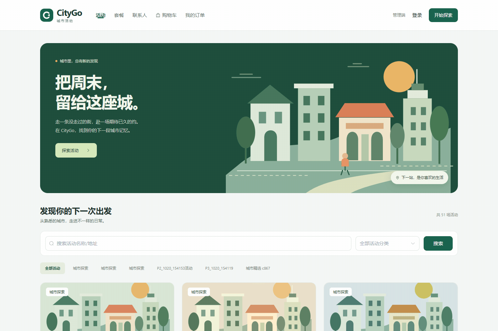
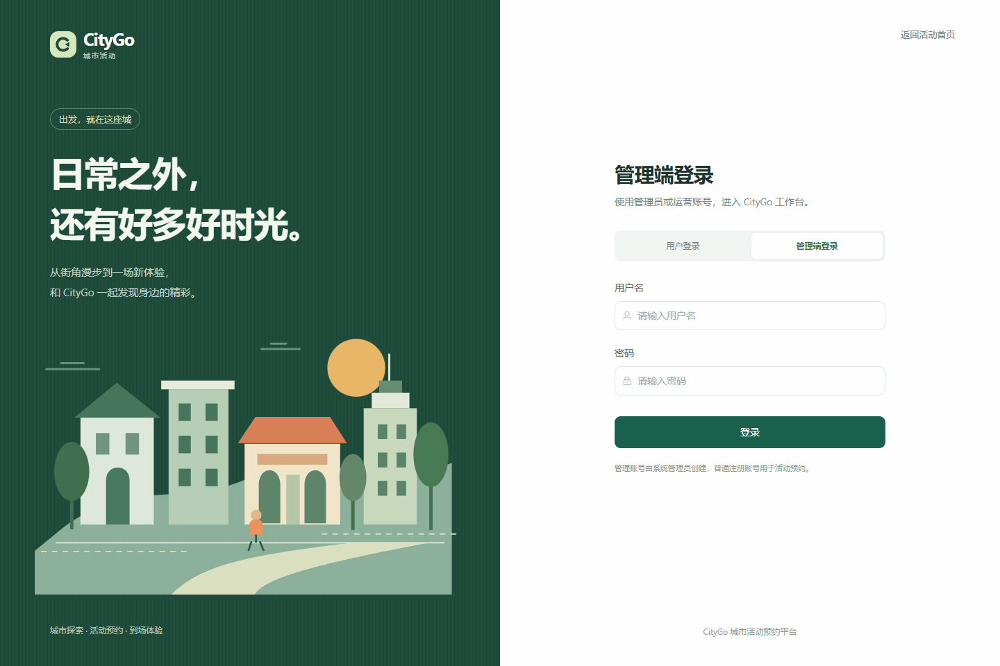
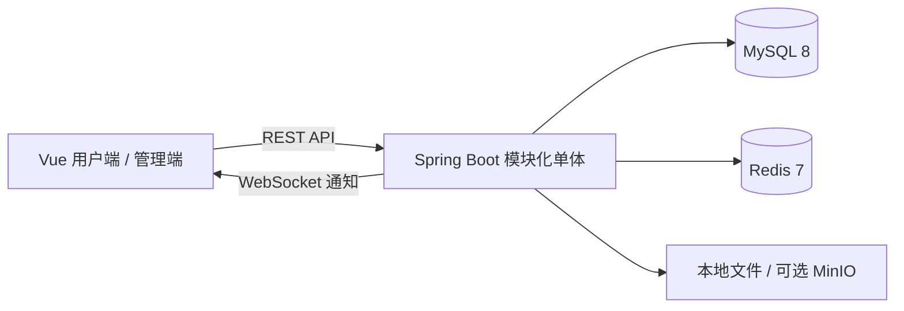

# CityGo · 城市活动与套餐预约平台

基于 **Java 21 + Spring Boot + Vue 3** 的城市活动预约项目，包含用户端和运营管理端。覆盖活动/套餐浏览、购物车、原子下单、模拟支付与退款、预约改期、二维码核销、实时通知和运营统计。

> 支付和退款均为模拟操作，不产生真实扣款。

## 用户端演示

浏览活动、管理联系人、选择场次、购物车下单、模拟支付、预约改期、出示核销码与查看完成记录。

## 管理端演示

登录运营工作台、管理活动、处理预约、核对改期信息、查看统计、扫码核销与查看完成订单。

## 核心功能

| 模块 | 已实现能力 |
| --- | --- |
| 用户端 | 注册登录、个人资料、默认联系人、活动/套餐浏览、搜索分类、购物车、订单与历史快照 |
| 预约流程 | 库存预占、下单幂等、模拟支付、取消与超时关单、确认、拒单退款、全额退款与核销 |
| 改期与二维码 | 同活动同原价整单改期、改期历史、5 分钟核销码、旧码失效、工作人员确认核销 |
| 运营管理 | 员工及角色、分类、活动、图片、场次、价格与名额、套餐版本、营业开关、订单和退款处理 |
| 实时通知 | 数据库 outbox、WebSocket 单次票据、消息持久化、重连补拉、催确认和活动提醒 |
| 报表与审计 | 按上海日期统计、销售排名、Excel 导出、防公式注入、员工操作审计 |
| 文件存储 | 本地图片存储、可选 MinIO/S3、类型/大小/归属校验、孤立文件清理 |

## 技术栈

| 层次 | 技术 |
| --- | --- |
| 后端 | Java 21、Spring Boot 3.5、Spring Security、JWT、MyBatis、Flyway、Bean Validation、AOP |
| 数据与缓存 | MySQL 8、Redis 7、数据库事务与行锁、唯一约束、outbox |
| 前端 | Vue 3、TypeScript、Vite、Vue Router、Pinia、Element Plus |
| 二维码与报表 | node-qrcode、ZXing、Apache POI |
| 基础设施 | Docker Compose、Nginx、可选 MinIO/S3、PowerShell 启动脚本 |

## 设计与实现要点

- **库存一致性**：商品行按场次汇总预占；锁内重验价格、状态、截止时间和名额。取消/退款按当前分配只释放一次，已完成履约不释放名额。
- **请求幂等**：下单键绑定规范化后的有效参数；同键同参返回原订单，同键异参拒绝。网络重试会复用请求键，避免重复创建订单。
- **快照与履约分离**：下单金额和商品快照不可变，改期维护独立履约快照、版本和历史；退款与核销时间以当前预约为准。
- **一次性二维码**：256 位随机值、5 分钟有效期、数据库仅存 SHA-256 哈希；绑定预约版本，员工登录校验与订单锁共同防止重复核销。
- **事务与通知解耦**：业务事务同时写入 outbox；提交后分发通知和更新缓存，失败可以重试，并按业务键去重。
- **鉴权与数据隔离**：服务端核验角色、账号启停和订单归属；退出令牌在 Redis 撤销，Redis 不可用时受保护请求失败关闭。
- 金额统一使用**整数分**；日期以 UTC 存储和传输，报表按 `Asia/Shanghai` 自然日汇总。

## 架构

模块化单体后端，Vue 单工程提供用户端 `/` 和管理端 `/admin`。

